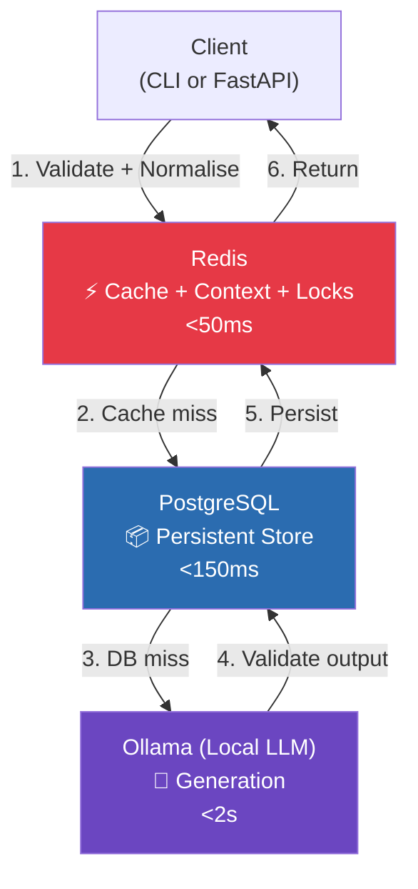
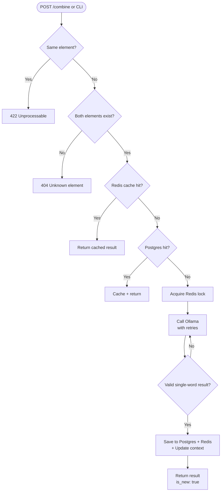
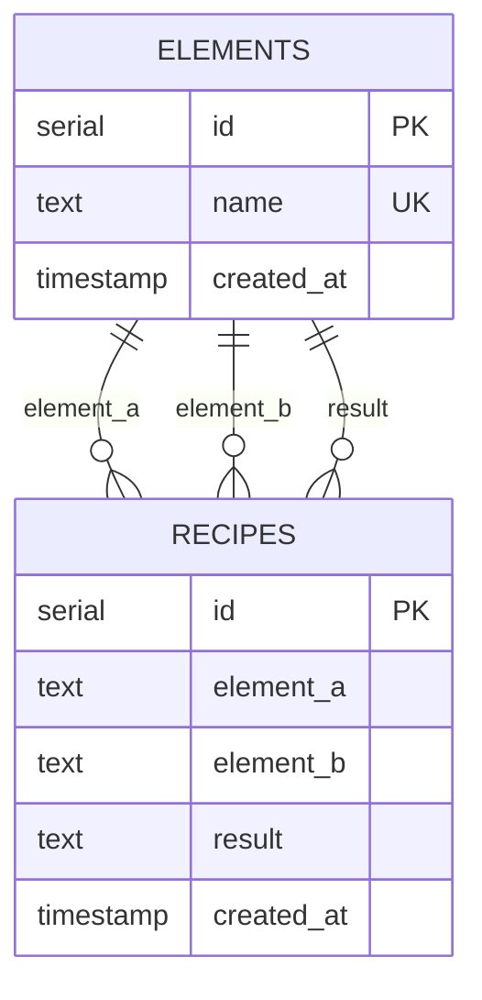
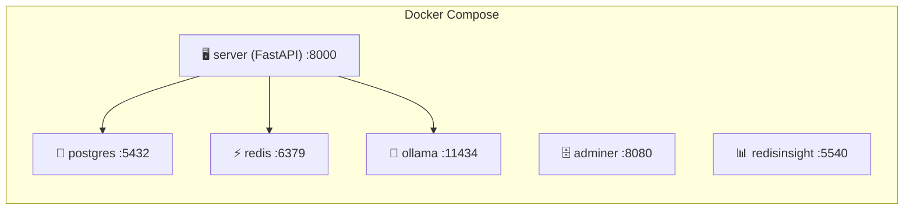

# 🏗️ Architecture.md

**Alchemy Crafter** — Infinite AI-powered alchemy discovery game.

A single-player crafting game where players combine elements to discover new ones, with results generated by a **local LLM (Ollama)** on first discovery and cached permanently.

---

## 🎯 High-Level Overview

Alchemy Crafter follows a **layered, cache-first architecture** optimized for low latency on repeated combinations while ensuring consistency and persistence.

The system gracefully degrades across layers:

1. **Redis** (fast cache) — sub-50ms responses
2. **PostgreSQL** (source of truth) — sub-150ms
3. **Ollama (local LLM)** — generates new discoveries (< 2s target)

All combinations are **order-independent** (`fire + water` == `water + fire`).

### Core Principles

- **Cache aggressively**, fall back safely
- **Never trust the LLM** without strict validation
- **Idempotent & consistent** results for the same pair
- **Fail silently** on cache/DB issues (non-blocking gameplay)
- **Single-word substance elements** only (no compounds, no fluff)

---

## 🧩 System Architecture



---

## 🔄 Combine Pipeline (Core Flow)



**Key behaviors**:

- Inputs are always **normalized and sorted** alphabetically.
- AI generation includes recent context (last `CONTEXT_SIZE` elements).
- Strict output validation (single lowercase word, alphanumeric + limited punctuation).
- Locking prevents duplicate AI calls for the same pair under contention.

---

## 📁 Project Structure

```text
alchemy-crafter/
├── src/
│   ├── config.py            # Env + settings
│   ├── logger.py            # Structured logging
│   ├── validation.py        # Input/output guards
│   ├── combine.py           # Main pipeline orchestration
│   │
│   ├── db/
│   │   ├── connection.py    # psycopg2 + retries
│   │   └── queries.py       # elements + recipes CRUD
│   │
│   ├── cache/
│   │   ├── connection.py    # Redis singleton
│   │   └── cache.py         # Recipe cache, context, locks, fail counters
│   │
│   ├── ai/
│   │   └── generator.py     # Prompt builder, Ollama client, parser
│   │
│   ├── api/
│   │   ├── app.py           # FastAPI factory + lifespan
│   │   └── routes.py        # /combine, /elements, /recipes
│   │
│   └── game/
│       ├── cli.py           # Interactive game loop
│       ├── state.py         # Session, streaks, milestones
│       └── display.py       # ANSI formatting
│
├── tests/                   # unit + integration tests
├── docker-compose.yml
├── Dockerfile.server
├── Makefile
└── pyproject.toml
```

---

## 🗄️ Data Model

### PostgreSQL



- `recipes` has a unique constraint on `(element_a, element_b)` with `element_a <= element_b`.

### Redis Keys

- `recipe:<a>:<b>` → cached result (TTL = `CACHE_TTL`)
- `context:global` → recent elements list (for AI prompt richness)
- `fail:<a>:<b>` → failure counter (for potential backoff)
- `lock:<a>:<b>` → distributed lock during generation

---

## 🐳 Docker Services



---

## 🔧 Key Design Decisions

| Decision                                 | Rationale                                                             |
| ---------------------------------------- | --------------------------------------------------------------------- |
| Sorted tuple for pairs                   | Guarantees `fire+water` == `water+fire` everywhere                    |
| Redis-first + silent failures            | Keeps gameplay responsive even if cache/DB is temporarily unavailable |
| Strict single-word validation            | Prevents "muddy water" or "a big explosion of flames" style outputs   |
| Context injection in prompts             | Makes later discoveries more coherent and thematically consistent     |
| Idempotent DB init + base seeds          | Safe restarts and consistent starting experience                      |
| Separate `elements` and `recipes` tables | Allows fast "does this element exist?" checks                         |

---

## 📈 Performance Targets

- **Cache hit**: < 50ms
- **DB hit**: < 150ms
- **AI generation**: < 2s (target)
- **Redis hit ratio goal**: > 70% after initial play

---

## 🛠️ Extensibility Points

- Easy to swap Ollama for other local/remote LLMs via `ai/generator.py`
- Context strategy can evolve (player-specific, thematic clusters, etc.)
- Future web UI can reuse the exact same `combine()` core
- Milestone/achievement logic lives in `game/state.py` and can be extended independently

---

## 📚 Related Documents

- [README.md](../README.md) — Overview and quick start
- [ROADMAP.md](./ROADMAP.md) — Product requirements and sprint list
- [Sprint 1](./sprints/S1/PRD.md), [Sprint 2](./sprints/S2/PRD.md) — Sprint scope
- [DECISION.md](./DECISION.md) — Decision log
- [STRUCTURE.md](./STRUCTURE.md) — Generated repository tree
- [API.md](./API.md) — Full endpoint reference

---

**Last updated:** May 2026  
**Status:** Core MVP architecture stable (Sprint 1 complete)
